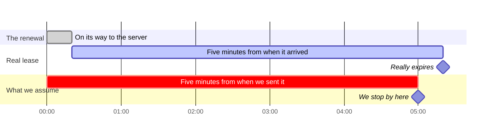

I've lost count of the number of times I've typed "distributed lock in MongoDB" into a search box. What comes back is always a handful of snippets that look about the same: a document with an `_id`, an owner and an expiry time. Grab it if it's free or it's expired, delete it when you're done, and get on with your day.

Don't get me wrong, those locks work. If you just need to stop the nightly report going out twice, a single document that says "I've got this" might be all you'll ever need. I'm not here to tell you otherwise.

But when I was building [Kevsoft.MigrateMongo](https://github.com/kevbite/Kevsoft.MigrateMongo.Tool), a database migration tool for .NET, I wanted a bit more than those snippets give you.

The lock in a migration tool isn't guarding a report. It's guarding your data. A backfill running twice at the same time makes for a much worse morning than a duplicate email.

I also had no idea where people would run it. Someone's laptop? A CI runner? A Fargate task [kicked off from GitHub Actions](https://kevsoft.net/2026/11/02/mongodb-migrations-in-csharp-from-github-actions.html)? Or [ten copies of an app all starting at once](https://kevsoft.net/2026/11/21/desired-state-mongodb-indexes-in-csharp.html), each one sure it's *their* job to run the migrations? Probably all of the above.

So the lock had to cope when things get awkward. Machines that can't agree on what time it is. A network that drops out just as the lock's being renewed. A database that switches to a new primary at exactly the wrong moment. And a process that nods off for a while, then wakes up convinced it still holds the lock.

In this post I'll walk through how locking works in the tool, the choices I made along the way, and why. Some of them I thought through properly up front. A couple I only got right after finding the hole they were plugging, and I'll own up to those as we go.

## What I wanted from it

Here's what I mean by a lock that "works":

- **Only one holder at a time.** That's the whole job, so it has to hold even when two processes ask in the same millisecond.
- **A crash can't leave it stuck forever.** If the holder dies, the lock has to free itself, without someone remembering to run a script at 2am.
- **A long job doesn't lose it.** A migration that backfills ten million documents can take a lot longer than any sensible timeout.
- **Everyone agrees on when it's expired.** Your laptop, a CI runner and a Fargate task can disagree about what time it is, and that mustn't matter.
- **A holder that's lost it finds out, and stops.** Especially before it writes something it shouldn't.
- **It tells you who has it.** "Waiting for lock" is unhelpful. "Waiting for the lock held by run 7f3c on ip-10-0-3-12, which expires at 14:05:00" is something you can act on.

## The lock everyone writes

Let's start with the lock you've probably already got, because it's where I started too.

The lock is a single document in a collection of its own. In the tool it lives in `_migrations.lock`, and looks something like this:

```javascript
{
  "_id": "lock",
  "runId": "7f3c9a…",
  "host": "ip-10-0-3-12",
  "acquiredAt": ISODate("2026-11-24T14:00:00Z"),
  "expiresAt": ISODate("2026-11-24T14:05:00Z"),
  "heartbeatAt": ISODate("2026-11-24T14:00:00Z")
}
```

Because `_id` is always unique in MongoDB, there can only ever be one document called `lock`. That's the "only one holder" rule sorted, without a single extra index.

The first version most of us write reads the lock, checks it, then writes it:

```csharp
var current = await locks.Find(x => x.Id == "lock").FirstOrDefaultAsync();
if (current is null || current.ExpiresAt < DateTime.UtcNow)
{
    await locks.ReplaceOneAsync(
        x => x.Id == "lock",
        new Lock { Id = "lock", Owner = me, ExpiresAt = DateTime.UtcNow.AddMinutes(5) },
        new ReplaceOptions { IsUpsert = true });

    // We've got it! Probably.
}
```

Spot the gap between the `Find` and the `ReplaceOneAsync`? Two processes can both read "it's free", both write, and both walk away thinking they've got the lock. The last one to write wins the document, but they're *both* off running migrations.

So the usual next step is to do the check and the write in one go, by putting the check in the filter:

```csharp
try
{
    await locks.UpdateOneAsync(
        x => x.Id == "lock" && x.ExpiresAt < DateTime.UtcNow,
        Builders<Lock>.Update
            .Set(x => x.Owner, me)
            .Set(x => x.ExpiresAt, DateTime.UtcNow.AddMinutes(5)),
        new UpdateOptions { IsUpsert = true });

    // Got it.
}
catch (MongoWriteException e) when (e.WriteError.Category == ServerErrorCategory.DuplicateKey)
{
    // Someone else has it.
}
```

Now MongoDB does the check and the write as one atomic operation, so the race has gone. This is the version you'll find in most of those snippets, and it's a perfectly decent lock.

It does have a couple of quirks, though. When someone else holds the lock, the filter doesn't match, so the upsert tries to insert a *second* document with an `_id` of `lock`, and MongoDB says no with a duplicate key error. So "someone else has it", the normal, everyday case while you're waiting, comes back as an exception. And it doesn't tell you *who* has it, so you need another read to say anything useful, by which point it might have changed hands.

(There's also that `DateTime.UtcNow`. Let's park that for now. It deserves a section all to itself.)

### Grabbing it in one go

What I wanted was a single operation that takes the lock if it's free, leaves it alone if it isn't, and tells me who holds it either way. MongoDB can do that with an [update that uses an aggregation pipeline](https://www.mongodb.com/docs/manual/tutorial/update-documents-with-aggregation-pipeline/). Instead of a plain list of `$set`s, the update becomes a little pipeline that can look at the document's current values and make decisions with them.

Here's a trimmed-down version of what the tool does (the full thing is in [MongoMigrationStore.cs](https://github.com/kevbite/Kevsoft.MigrateMongo.Tool/blob/main/src/Kevsoft.MigrateMongo.MongoDriver/MongoMigrationStore.cs)):

```csharp
// Has the current lock expired? A brand new document has no expiresAt,
// and a missing field sorts before any date, so a new lock counts as expired.
var expired = new BsonDocument("$lt", new BsonArray { "$expiresAt", "$$NOW" });

// If we're taking the lock, use the new value; otherwise keep what's there.
static BsonDocument IfTaken(BsonValue value, string field) =>
    new("$cond", new BsonArray { "$_take", value, "$" + field });

var update = Pipeline(
    new BsonDocument("$set", new BsonDocument("_take", expired)),
    new BsonDocument("$set", new BsonDocument
    {
        { "runId", IfTaken(new BsonDocument("$literal", runId), "runId") },
        { "host", IfTaken(new BsonDocument("$literal", host), "host") },
        { "acquiredAt", IfTaken("$$NOW", "acquiredAt") },
        { "expiresAt", IfTaken(ExpiresIn(ttl), "expiresAt") },
        { "heartbeatAt", IfTaken("$$NOW", "heartbeatAt") },
    }),
    new BsonDocument("$unset", "_take"));

var document = await locks.FindOneAndUpdateAsync(
    new BsonDocument("_id", "lock"),
    update,
    new FindOneAndUpdateOptions<BsonDocument> { IsUpsert = true, ReturnDocument = ReturnDocument.After });

return document["runId"] == runId ? ToLock(document) : null;
```

There's a fair bit going on there, so let's walk through it. (`Pipeline` is just a small helper that wraps the stages up as the driver's `PipelineUpdateDefinition`.)

The pipeline has three stages. The first works out whether the lock is up for grabs, and stashes the answer in a scratch field called `_take`. The second sets every field with `$cond`, which is MongoDB's version of `? :`. It picks our new value if `_take` is true, and keeps the existing value if not. The third removes `_take` again, so it never gets stored. And `$literal` wraps our own values so MongoDB never mistakes one for a field name, just in case a host name ever starts with a `$`.

The filter is only `_id`, so it always matches the lock document, or creates it if there isn't one. No more duplicate key errors while we wait. And because we ask for the document as it is *after* the update, we get back whoever holds the lock now. If its `runId` is ours, we've got it. If not, we know exactly who has, and can say so.

There's one tiny race left. If there's no lock document at all, and two runs try to create it at exactly the same moment, one of them can still get a duplicate key error. MongoDB retries that for you in a lot of cases, but not all of them, so the tool catches it and treats it as "someone else got there first", which is exactly what happened:

```csharp
catch (MongoCommandException e) when (e.Code == 11000)
{
    // Another run created the lock at the same moment; that run has it.
    return null;
}
```

You've probably spotted `$$NOW` in there too. That's where the clocks come in.

## Whose clock is it anyway?

Here's a question that sounds easy. What time is it right now?

Look at your watch and you've got an answer. Look at your watch *and* your phone, and you've probably got two answers, a few seconds apart. Ask five people in the office and you'll get five, and the gap between the earliest and the latest will be bigger again. So which one's right? Honestly, none of them exactly.

There's an old saying for this, known as [Segal's law](https://en.wikipedia.org/wiki/Segal%27s_law): someone with one watch knows what time it is, and someone with two watches is never sure.

Computers are no better. Every machine keeps its own clock, and every clock drifts. NTP (the service that keeps clocks in step over the network) gets them close, but close isn't the same as equal. A VM that's been paused and resumed, or a laptop that's just come out of sleep, can be a long way out until it catches up.

And containers don't get a clock of their own. They use the host's, so a container on a drifting VM drifts right along with it. If you're on a Mac or Windows, that's you: Docker Desktop runs your containers inside a little Linux VM, and that VM's clock has a habit of falling behind after your laptop's been asleep.

Now think about what a lock with an expiry time is really asking. It's asking a room full of watches to agree on exactly when "five minutes from now" ends. And the more places the tool runs, the more watches there are in the room.

Look back at those snippets from earlier. Both of them work out the times with `DateTime.UtcNow`, the machine's own clock. Taking the lock writes `expiresAt` as "my now, plus five minutes", and checking whether a lock has expired compares it with "my now". Which is fine, right up until two machines disagree about what "now" is.

Say a run holds the lock, and by the database server's clock it's got one minute left. Here's what three other machines make of it:

| This machine's clock | What it thinks | What it does |
|---|---|---|
| Spot on | One minute left | Waits, as it should |
| Two minutes slow | Three minutes left | Waits longer than it needs to |
| Two minutes fast | Expired a minute ago | Takes over a lock that's still in use |

The slow one is a bit annoying. The fast one is a proper problem: two runs, both sure they hold the lock, both changing your data. And the drift doesn't even have to be big. It only has to be bigger than however long the lock has left.

The fix is to stop comparing watches altogether, and have everyone read the one clock on the wall: the database server's. It doesn't matter if that clock is a bit wrong, as long as everyone's reading the same one.

MongoDB gives you that clock as [`$$NOW`](https://www.mongodb.com/docs/manual/reference/aggregation-variables/#mongodb-variable-variable.NOW), a variable that holds the server's current time. You can only use it in aggregation expressions, and the same goes for `$cond`. So that's why the update above is a pipeline. It isn't there to be clever. It's the only way to get the server to do the sums.

Every time in the lock comes from it:

```csharp
// Has it expired? Asked of the server's clock, not ours.
private static BsonDocument Expired =>
    new("$lt", new BsonArray { "$expiresAt", "$$NOW" });

// "Five minutes from now", where "now" is the server's.
private static BsonDocument ExpiresIn(TimeSpan ttl) =>
    new("$add", new BsonArray { "$$NOW", (long)ttl.TotalMilliseconds });
```

And it's not just taking the lock. Anything that asks "has it expired?" asks the server. When `migrate-mongo unlock` checks whether it's safe to remove a lock, or a dry run warns you that someone else is holding it, the tool reads the lock with a small aggregation that works out `expired` on the server. It never pulls back `expiresAt` and compares it with `DateTime.UtcNow`. The client's clock doesn't get a vote.

It's also the kind of problem your tests won't find on their own, because every test runs on one machine, with one clock. We'll come back to that at the end.

### Why not use a TTL index?

You might be wondering why I don't put a [TTL index](https://www.mongodb.com/docs/manual/core/index-ttl/) on `expiresAt` and let MongoDB delete expired locks for me. It's tempting. It'd tidy up after crashed runs for free.

The catch is that the TTL monitor is a background job that runs about once a minute, and it makes no promises about when it'll get round to a particular document. An expired lock can hang about for a while after it's expired. That's fine for tidying up old sessions, but it's no good as the thing that decides who holds the lock. In the tool, "has it expired?" is always a comparison with `$$NOW`, never "has it been deleted yet?"

## Not letting the connection string decide

This one's a bit dull, but it's the kind of thing nobody thinks about until there's a failover at 3am.

Most production MongoDB runs as a *replica set*: one *primary* that takes all the writes, and a couple of *secondaries* that copy everything from it, ready to take over if it falls over. That copying isn't instant, and that causes two problems for a lock.

The first is reads. If your connection string says `readPreference=secondaryPreferred`, which is quite common in read-heavy apps, the lock gets read from a secondary that might be a few seconds behind. It could tell you the lock is free when someone took it a moment ago.

The second is writes. With a [write concern](https://www.mongodb.com/docs/manual/reference/write-concern/) of `w: 1`, the primary says "done" as soon as *it* has your write. If it then falls over before the secondaries have copied it, a new primary takes over that's never heard of your lock, and your write gets rolled back. You took the lock, MongoDB said yes, and now it's gone.

The answer to both is *majority*. A write concern of `majority` waits until most of the replica set has the write, so it survives a failover. A [read concern](https://www.mongodb.com/docs/manual/reference/read-concern/) of `majority` only returns data that most of the replica set has, so you never read something that's about to be rolled back.

The first version of the lock just used whatever the connection string, or your app's own `IMongoClient`, said. That's one I only caught in a review, so I'll put my hand up to it. Now the tool ignores all of that for its own collections:

```csharp
// Always the primary, with majority reads and writes, whatever the connection string says.
database = database
    .WithReadPreference(ReadPreference.Primary)
    .WithReadConcern(ReadConcern.Majority)
    .WithWriteConcern(WriteConcern.WMajority);
```

Your migrations can still use whatever settings you like. It's only the lock, and the record of which migrations have run, that insist on doing it properly. It costs a few milliseconds per lock operation, and that's a trade I'll take every time.

## A lock that lets go on its own

So far the lock has an expiry time, which deals with crashes. If a run dies, its lock expires, and the next run can take it. But that raises a new question: how long should it last?

Too short, and a long migration outlives its own lock. Too long, and after a crash everyone's stuck waiting. Backfilling ten million documents might take an hour, but nobody wants to wait an hour after a crash.

The answer is to make it a *lease* rather than a lock: something that runs out fairly quickly unless you keep renewing it. The renewing is called a *heartbeat*. As long as the run is alive, it keeps saying "still here", and the lease keeps getting extended. If it crashes, the heartbeats stop and the lease runs out on its own.

In the tool, the lease lasts five minutes (that's `lockTtl`, if you want to change it), and the heartbeat runs every third of that, so every 100 seconds. That gives each lease two spare chances to be renewed before it runs out, which comes in handy when the network has a wobble.

Renewing is a small update, and once again, every time in it is the server's:

```csharp
var result = await locks.UpdateOneAsync(
    new BsonDocument { { "_id", "lock" }, { "runId", runId } },
    Pipeline(new BsonDocument("$set", new BsonDocument
    {
        { "expiresAt", ExpiresIn(ttl) },
        { "heartbeatAt", "$$NOW" },
    })));

return result.MatchedCount == 1;
```

The important bit is `runId` in the filter. If our lease ran out and someone else took over, it's their `runId` on the document now, so the filter doesn't match and `MatchedCount` comes back as zero. That's how a run finds out it's lost the lock. We'll come back to what it does about it.

Releasing the lock at the end works the same way:

```csharp
await locks.DeleteOneAsync(new BsonDocument { { "_id", "lock" }, { "runId", runId } });
```

Without `runId` in that filter, a run whose lease had quietly expired would finish up and delete someone *else's* lock on its way out. That's the sort of bug that takes days to find.

### Keeping the heartbeat going until the work has really stopped

One more subtle thing. When you press Ctrl+C, or your deploy cancels the task, the tool asks the running migration to stop by cancelling its `CancellationToken`. But asking isn't the same as stopping. A migration halfway through an `UpdateManyAsync` on a big collection is still changing data until the server's finished, and a migration that ignores its token will carry on until it's done.

If the heartbeat stopped as soon as cancellation was requested, the lease could run out while that migration was still writing, and another run could start alongside it. So the heartbeat keeps going until the work has actually *returned*, not just until someone asks it to stop:

```csharp
using var lockLost = new CancellationTokenSource();
using var cancelled = CancellationTokenSource.CreateLinkedTokenSource(cancellationToken, lockLost.Token);
using var finished = new CancellationTokenSource();

var heartbeat = HeartbeatAsync(lockLost, acquired.Requested, finished.Token);
try
{
    // The migrations see "cancelled": Ctrl+C, or the lock being lost.
    return await action(cancelled.Token);
}
finally
{
    // The heartbeat only stops once the migrations have actually returned.
    await finished.CancelAsync();
    await heartbeat;
    await _store.ReleaseLockAsync(RunId, CancellationToken.None);
}
```

There are three tokens here, and each one has its own job. `cancelled` is what the migrations see, and it fires if you press Ctrl+C *or* the lock is lost. `lockLost` is how the heartbeat tells everyone the lock has gone. And `finished` is the heartbeat's own off switch, which only gets flicked once the migrations have returned.

## The one clock on your machine you *can* trust

So I've spent a whole section telling you not to trust your machine's clock, and now I need it. Awkward.

The heartbeat has to answer a question only this machine can: "how long have I got before my lease runs out?" If renewals keep failing (the network's down, say), at some point the run has to accept that it might have lost the lock, and stop. And it has to work that out *without* asking the database, because talking to the database is the thing that's failing.

Here's the thing, though. Your computer has two kinds of clock. There's the *wall clock*, `DateTime.UtcNow`, which tells you the time of day. That's the one that drifts, gets nudged by NTP, and can even jump backwards. Then there's the *monotonic clock*, which you get from `Stopwatch` or `TimeProvider.GetTimestamp()`. It can't tell you the time of day at all, but it only ever moves forwards, at a steady pace. It's not a watch, it's a stopwatch. And for "how long has it been?", a stopwatch is all you need.

The trick is *when* you start the stopwatch. The tool starts it when it **sends** a renewal, not when the reply comes back:



(I've made the request take a very leisurely 20 seconds so you can actually see it. In real life it's a few milliseconds.)

The server sets the new expiry to its own "now", plus the lease time. Its "now" is always a little later than the moment we sent the request, because the request had to get there first. So "lease time since we sent it" always ends a bit *before* the real expiry. However wrong the server's clock is, and however long the request took, the run's idea of when its lease runs out is on the safe side. (Strictly speaking, that assumes both clocks tick at about the same speed. Over a few minutes, they do.)

Here's the heartbeat loop, trimmed down:

```csharp
var interval = _options.LockTtl / 3;
while (!finished.IsCancellationRequested)
{
    await Task.Delay(interval, _time, finished);

    var requested = _time.GetTimestamp();
    try
    {
        if (await _store.RenewLockAsync(RunId, _options.LockTtl, finished))
        {
            renewed = requested; // timed from when we *sent* it
            continue;
        }

        // The update didn't match: someone else has the lock now.
        await lockLost.CancelAsync();
        return;
    }
    catch (Exception)
    {
        // A blip, like an election or a dropped connection. Try again,
        // unless the next attempt would land after the lease runs out.
        if (_time.GetElapsedTime(renewed) + interval >= _options.LockTtl)
        {
            await lockLost.CancelAsync();
            return;
        }
    }
}
```

(An *election* is a replica set choosing a new primary. It usually takes a few seconds, writes fail while it happens, and then everything carries on.)

So a renewal can fail in two ways, and they're handled very differently. If the update ran but didn't match, the lease is definitely someone else's, so stop now. If the update didn't run at all, we don't know either way, so keep trying, but only while there's definitely time left. As soon as the next attempt would land after the lease might have run out, stop, rather than hope.

`_time` is a [`TimeProvider`](https://learn.microsoft.com/en-us/dotnet/api/system.timeprovider), which is .NET's way of letting you swap the clock out. In production it's the real system clock. In the tests, it's one I control, and we'll get to that.

## Stopping before it's too late

When the heartbeat decides the lock has gone, it cancels `lockLost`, and with it the token the migrations are using. But a cancellation token is a polite request, not a guarantee. The driver only notices it the next time it talks to the server, and your migration code only notices if it checks.

So the tool doesn't leave it to chance. Before every migration, it checks for itself (trimmed again):

```csharp
foreach (var migration in pending)
{
    if (LockLost(ct, cancellationToken) is { } lost)
    {
        return lost; // "Lost the migration lock; stopped before the next migration."
    }

    await ApplyAsync(migration, batch, outputOptions, ct);
}
```

That way, a run that's lost the lock never *starts* another migration. It stops with a clear message and a failing exit code, rather than an `OperationCanceledException` from somewhere deep inside the driver. It's kept separate from you pressing Ctrl+C, too, which still cancels the normal way, so the output tells you what actually happened.

But that still leaves a gap, doesn't it? What about the migration that's already running when the lock goes?

## The process that nodded off

Here's the hole that every lease-based lock has, whichever database it's in.

A run takes the lock and starts a migration. Then, partway through, the whole process just... stops. It doesn't crash, it stops. A long garbage collection pause. A VM that's paused while it's moved to another host. A laptop lid closed for lunch. While it's out, the heartbeat can't run, the lease expires, and another run takes over and applies the same migration.

Then the first process wakes up. As far as it knows, no time has passed at all, and it still holds the lock. So it finishes its migration and commits.

No amount of checking can fix this on its own, because the pause can happen straight *after* the check. Martin Kleppmann wrote a brilliant post about exactly this, [How to do distributed locking](https://martin.kleppmann.com/2016/02/08/how-to-do-distributed-locking.html). His answer is *fencing*: the thing you're protecting has to turn away writes from a holder that's been replaced, rather than trusting the holder to know.

This is the other one I have to own up to. I only spotted it recently, and [raised it as an issue on the tool](https://github.com/kevbite/Kevsoft.MigrateMongo.Tool/issues/50): a migration running in a transaction could commit after losing the lock, and overwrite the record of the run that had taken over. Everything would look fine, but two runs would have applied the same migration.

### Fencing with a write conflict

The good news is that when a migration runs in a transaction, and the tool uses one whenever it can, MongoDB already has exactly what we need. If two transactions change the same document, only one of them can commit. The other gets a *write conflict*, and is rolled back.

So the trick is to make "who owns the lock" a document that every migration's transaction has to write to before it commits. The tool keeps a second document next to the lease, called the *fence*:

```javascript
{ "_id": "fence", "runId": "7f3c9a…", "fencedAt": ISODate("2026-11-24T14:03:12Z") }
```

Taking the lock, taking over an expired one, and unlocking all change the lease *and* the fence together, in a single transaction. Then, once a migration has done its work, and just before its transaction commits, the tool does two things:

```csharp
// 1. Is the lease still ours? Asked outside the transaction.
var lease = await locks.Find(new BsonDocument
{
    { "_id", "lock" },
    { "runId", runId },
    { "$expr", new BsonDocument("$gte", new BsonArray { "$expiresAt", "$$NOW" }) },
}).FirstOrDefaultAsync(cancellationToken);

if (lease is null)
{
    return false;
}

// 2. Touch the fence, inside the transaction.
var result = await locks.UpdateOneAsync(session,
    new BsonDocument { { "_id", "fence" }, { "runId", runId } },
    Pipeline(new BsonDocument("$set", new BsonDocument("fencedAt", "$$NOW"))));

return result.MatchedCount == 1;
```

If either step says no, the migration refuses to commit ("The migration lock was lost; refusing to commit the transaction"), and everything it did gets rolled back.

The second step is where the magic happens. Writing to the fence inside the migration's transaction ties the two together. If anyone has taken over since the transaction started, they've changed the fence too, so our write conflicts and the transaction can't commit. And if someone tries to take over *after* we've touched the fence, it's their transaction that has to wait for ours to finish. Either we commit while we still own the lock, or we don't commit at all.

### Why two documents, and why check outside?

This is where the war story comes in, because my first go at this got both of those wrong.

The first version fenced on the lease document itself, and checked it inside the transaction. It seemed neater: one document, one check. But a transaction reads from a *snapshot*, a picture of the database as it was when the transaction started. A migration that's been running for a few minutes is looking at a lease from a few minutes ago, from before its latest heartbeats.

Worse, the heartbeat writes to the lease every 100 seconds. So a long migration's transaction would touch the lease, its own heartbeat would touch it too, and they'd conflict. The lock was tripping over its own feet.

Splitting them apart fixed both. The lease is the thing that changes all the time, and only heartbeats and takeovers write to it. The fence only changes when ownership does, so the only thing a migration can conflict with is a real takeover. And the lease check happens outside the transaction, so it always sees the latest heartbeat rather than an old snapshot.

### What fencing can't cover

I want to be honest here, because this is where a lot of locking write-ups go a bit quiet. Fencing like this only works for work done *inside* a transaction.

Some things can't be. Standalone MongoDB servers don't support transactions at all. Index builds don't run in them, and big backfills often shouldn't, because transactions have [limits on how long they can run and how much they can change](https://www.mongodb.com/docs/manual/core/transactions-production-consideration/). For those, the lease, the heartbeat and stopping between migrations are what you've got.

There is one extra safety net. Before a migration that isn't in a transaction starts, the tool *inserts* a record saying it's being applied, rather than upserting one. If another run has already recorded that migration, the insert fails with a duplicate key, instead of quietly writing over it.

That's a lot better than nothing, but it isn't a guarantee, and I'd rather tell you that than pretend otherwise.

## Waiting your turn

Most of the time, none of this drama happens. Someone else just has the lock, and you have to wait.

The tool tries to take the lock every second, for up to a minute (`lockWaitTimeout`). While it waits, it tells you who you're waiting for, once per holder rather than every second:

```text
Waiting for lock held by run 7f3c9a… (ip-10-0-3-12), which expires at 2026-11-24 14:05:00Z.
```

If the minute's up and it still hasn't got it, it stops with exit code `3`, so your pipeline knows *why* it failed, not just that it did.

This is also what makes [running migrations when your app starts](https://kevsoft.net/2026/11/21/desired-state-mongodb-indexes-in-csharp.html) safe. Ten instances start at once. One gets the lock and runs the migrations. The other nine wait, then take the lock in turn, find there's nothing left to do, and get on with starting up.

And if a run really has died and you don't fancy waiting out its lease, there's `unlock`:

```bash
migrate-mongo unlock           # only removes it if the server says it's expired
migrate-mongo unlock --force   # removes it whatever, so be sure
```

Plain `unlock` asks the server whether the lock has expired, so it can't pull the rug out from under a run that's still going. `--force` removes it anyway, which is exactly as dangerous as it sounds. It's there for when you *know* the run has gone, because you're looking at the stopped task. It changes the fence as well, though, so if that run wasn't quite as dead as you thought, it still can't commit a transaction.

## Proving it with real MongoDB

You knew I couldn't write a post like this without talking about tests.

Locks are notoriously hard to test, because the interesting bugs only turn up when things happen in an awkward order, on more than one machine. Two things make it manageable.

### Faking the clocks

Because the engine gets its time from a `TimeProvider`, a test can hand it any clock it likes. Here's the test that keeps the machines' clocks out of it. One machine's clock is an hour fast, another's is an hour slow, and the only clock that's allowed to matter is the server's:

```csharp
[Fact]
public async Task Lock_expiry_follows_the_store_clock_not_this_machines()
{
    var storeNow = new DateTime(2026, 10, 30, 12, 0, 0, DateTimeKind.Utc);
    var store = new FakeStore(() => storeNow);
    store.Lock = new LockInfo { RunId = "other", AcquiredAt = storeNow.AddMinutes(-1), ExpiresAt = storeNow.AddMinutes(4) };
    MigrationDescriptor[] migrations = [Migrations.Create("20260101000001", "a")];
    var options = new EngineOptions { LockWaitTimeout = TimeSpan.Zero };

    // This machine's clock is an hour ahead, but the lock hasn't expired as far as the store is concerned.
    var ahead = new MigrationEngine(store, new FakeExecutor(), migrations, options, _sink, new FixedTime(storeNow.AddHours(1)));
    (await ahead.UpAsync(null, CancellationToken.None)).ExitCode.ShouldBe(ExitCodes.LockTimeout);
    store.Lock!.RunId.ShouldBe("other");

    // Once it has expired by the store's clock, a machine whose clock is an hour behind takes it over.
    storeNow = storeNow.AddMinutes(5);
    var behind = new MigrationEngine(store, new FakeExecutor(), migrations, options, _sink, new FixedTime(storeNow.AddHours(-1)));
    (await behind.UpAsync(null, CancellationToken.None)).ExitCode.ShouldBe(ExitCodes.Success);
}
```

`FixedTime` is a tiny `TimeProvider` that always says it's the same time. There's no sleeping and no waiting five minutes for a lease to run out, so the whole thing runs in milliseconds.

### Racing against the real thing

A fake store is great for testing the engine's decisions, but the hard parts of this lock live in MongoDB itself: the pipeline update, the transactions, the write conflicts. You can't fake those and trust the result. So those tests run against a real replica set in Docker, using [Testcontainers](https://dotnet.testcontainers.org/) and MongoDB Atlas Local.

This one plays out the nodded-off story exactly. The old owner starts a transaction and records a migration. Then, while it isn't looking, its lease expires and a new owner takes over. When the old owner wakes up and tries to fence, it's turned away, and nothing it wrote survives:

```csharp
(await store.TryAcquireLockAsync("old-owner", null, TimeSpan.FromMinutes(1), ct)).ShouldNotBeNull();

var session = await client.StartSessionAsync();
session.StartTransaction();
await using (var scope = new MongoExecutionScope(session))
{
    await store.SaveStateAsync(new StoredMigrationState
    {
        Id = "20260101000001",
        State = MigrationStates.Applied,
        RunId = "old-owner",
        Batch = 1,
    }, scope, ct);

    // While the old owner isn't looking, its lease runs out and someone else takes over.
    await locks.UpdateOneAsync(
        new BsonDocument("_id", "lock"),
        new BsonDocument("$set", new BsonDocument("expiresAt", DateTime.UtcNow.AddMinutes(-1))));
    (await store.TryAcquireLockAsync("new-owner", null, TimeSpan.FromMinutes(1), ct)).ShouldNotBeNull();

    // The old owner wakes up and tries to commit.
    (await store.FenceLockAsync("old-owner", scope, ct)).ShouldBeFalse();
}

(await store.GetStatesAsync(ct)).ShouldBeEmpty();
```

There are tests next to it for the other awkward orders too: a forced unlock in the middle of a transaction, a heartbeat that lands after the transaction's snapshot, and a takeover that has to wait for a transaction that's already fenced. Every hole in this post has a test that recreates it against a real MongoDB.

## Wrapping up

The simple lock you found online is fine, and for plenty of jobs it's all you'll need. But when the thing you're protecting is your data, and you've no idea where the tool's going to be run, it pays to be a bit more suspicious. Nearly every choice in the tool's lock comes down to not trusting something:

- **Don't trust a read followed by a write.** Take the lock in one atomic update that tells you who holds it.
- **Don't trust the machines' clocks.** Every time comes from `$$NOW`, the server's clock.
- **Don't trust the connection string.** The lock always uses the primary, with majority reads and writes.
- **Don't trust a lock to last forever.** Make it a lease that runs out, and keep it alive with a heartbeat.
- **Don't trust that you still hold it.** Time the lease from when you *sent* the renewal, and stop before it could run out.
- **Don't trust a process that's been asleep.** Fence the commit, so a holder that's been replaced can't write.

If you want the full details, the [Safety page](https://github.com/kevbite/Kevsoft.MigrateMongo.Tool/wiki/Safety) in the tool's wiki covers it all, and the code's all on [GitHub](https://github.com/kevbite/Kevsoft.MigrateMongo.Tool).

What do you reach for when you need "only one of these at a time"? A MongoDB document, Redis, a database advisory lock, or crossed fingers? Let me know in the comments.
